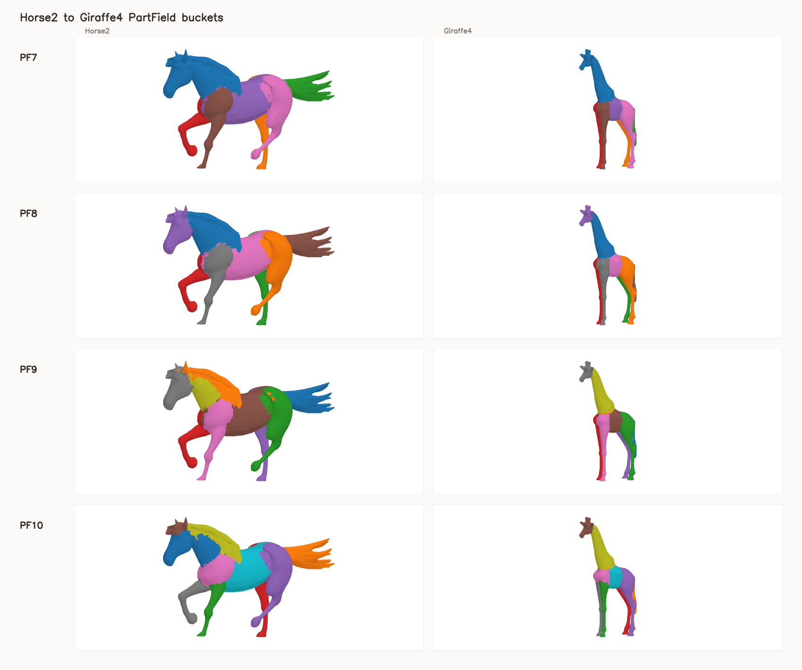
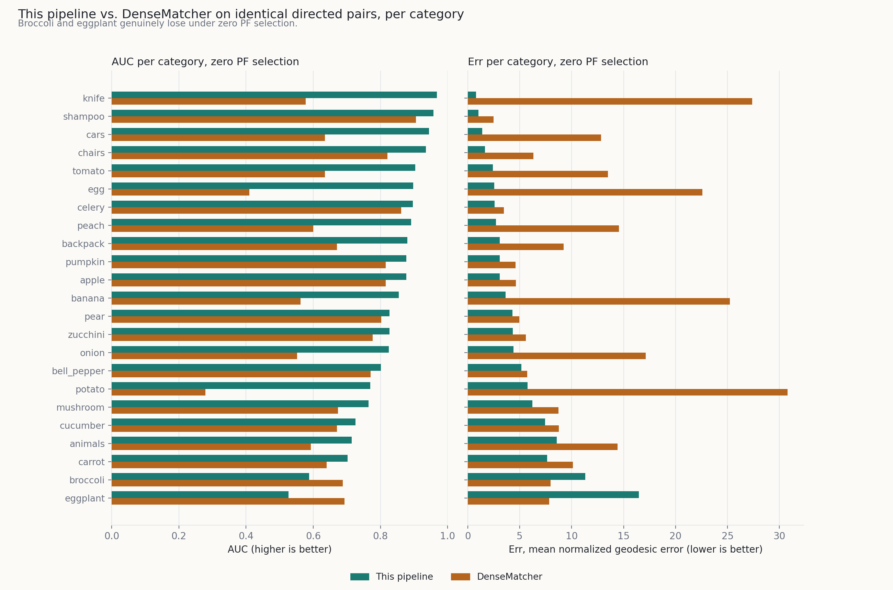

# MeshUp v2 Working Handoff

This repository contains the MeshUp deformation code plus the recent
target-guidance, PartField, DenseCorr3D, and SAM3D mesh-preparation work.

## Final Report: Semantic-Guided Mesh-to-Mesh Deformation

PartField-guided Chamfer optimization for mesh-to-mesh deformation, scored against
DenseMatcher's own predicted correspondences on identical DenseCorr3D pairs under an
identical graph-geodesic evaluator. Headline result: **21 of 23 categories** beat
DenseMatcher with zero PartField-level selection (mean AUC 0.824 vs. 0.672); on the 12
categories that needed no assisted orientation, it still wins 10 of 12.

<p>
  
  
</p>

- **Report (PDF):** [`report_final/main.pdf`](report_final/main.pdf)
- **Video showcase:** hover-to-play deformation clips plus the headline numbers --
  live at the GitHub Pages site for this repo once enabled in Settings -> Pages
  (source: `main` branch, `/docs` folder); source lives in `docs/index.html`.

## Current Work Areas

- `jobs_with_target_guidance/`: current target-guidance code, configs, SLURM jobs,
  reports, semantic correspondence utilities, DenseCorr3D converters, and
  curated prepared labels/meshes.
- `jobs_with_sam3D/`: small SAM3D-related job wrappers and the processed 5k car
  meshes consumed by the car target-guidance configs.
- `mesh_creator_for_meshup/`: local SAM2/SAM3D image, mask, metadata, and mesh
  preparation workspace. The upstream SAM/SAM3D checkouts, checkpoints,
  package caches, and Conda environments are intentionally ignored.
- `semantic_tracking/`, `configs/`, `main.py`, and `loop_tracked.py`: core MeshUp
  deformation and guidance code.

## Setup Pointers

Use `activate_meshup_new.sh` for the local MeshUp environment assumptions.
`env_meshup_new_export.yml` captures the exported environment.

Heavy third-party code and models are not stored in Git. Recreate them with:

```bash
jobs_with_target_guidance/scripts/setup_partfield_checkout.sh
bash mesh_creator_for_meshup/scripts/setup_sam3d_env.sh
```

See these task-specific docs for the latest recipes:

- `jobs_with_target_guidance/README.md`
- `jobs_with_target_guidance/cross_animal_spike_runs/README.md`
- `jobs_with_target_guidance/densematcher_runs/README.md`
- `mesh_creator_for_meshup/README.md`

## What Git Keeps

The repo keeps code, configs, job scripts, reports, source images/masks, compact
prepared meshes, labels, summaries, and selected feature arrays that are useful
for continuing the recent experiments on another server.

The repo ignores raw optimizer outputs, logs, TensorBoard files, temporary
Jacobian/correspondence caches, local package caches, model checkpoints, Conda
environments, and third-party dependency checkouts. This keeps normal Git usable
and avoids files that GitHub rejects.
