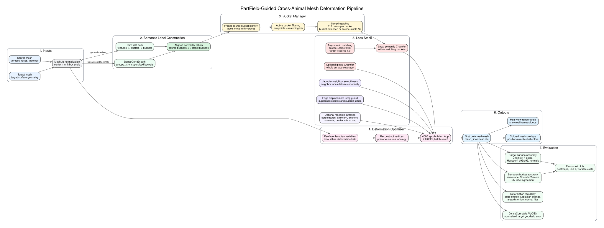

# Pipeline And Evaluation Deep Dive

Date: 2026-08-03

Working project title:

**PartField-Guided Cross-Animal Mesh Deformation With Semantic Bucket Chamfer And Regularized Jacobian Optimization**

## Short Supervisor Framing

The project is not a simple "make mesh A look like mesh B" Chamfer baseline. The current pipeline is a target-guided 3D optimization system with four important scientific pieces:

1. **A semantic decomposition of the surface** into corresponding part buckets.
2. **A local, bucket-restricted Chamfer objective** so each source part is pulled toward the matching target part.
3. **An asymmetric matching strategy** that prioritizes covering the target while avoiding source over-pulling.
4. **A topology-preserving deformation model with regularizers** that suppress spikes, discontinuities, and local folding.

The strongest way to say the core idea is:

> I deform the source mesh in 3D, but the matching is not only global. The target attraction is decomposed into semantic regions, and the deformation field is regularized so neighboring faces move coherently. This makes the optimization part-aware, target-aware, and geometry-aware.

## Pipeline Graph

The slide-friendly rendered version of this graph is:



The source for the diagram is:

`jobs_with_target_guidance/cross_animal_spike_runs/reports/pipeline_and_evaluation_graph.dot`

## One-Line Technical Thesis

The pipeline optimizes a source mesh `S` into a deformed mesh `S'` that approximates a target mesh `T`, while preserving source topology and forcing semantic regions of `S'` to match the corresponding semantic regions of `T`.

In equation form, the practical best-run objective is:

```text
L_total =
    8000 * L_local_semantic_bucket_chamfer
  +    0 * L_global_chamfer
  + 1000 * L_jacobian_neighbor_smoothness
  +  500 * L_edge_displacement_jump
  + optional research terms
```

The final selected runs are named `hard_partfield_chamfer_only`. That name matters. The codebase supports global Chamfer, but the best inspected configs set `target_mesh_chamfer_weight = 0.0` and drive the deformation mainly through local semantic bucket Chamfer plus deformation regularization.

## Full Pipeline From Start To Finish

### Stage 1: Source And Target Mesh Input

The pipeline starts with:

- a **source mesh**, whose vertex positions are allowed to move;
- a **target mesh**, whose surface defines the desired final shape;
- the source mesh topology, which is preserved through the deformation.

The output is not a newly generated target topology. It is the source mesh deformed into the target's shape. That means the final mesh keeps the source connectivity: the same vertex/face graph is bent, stretched, and reshaped.

This is important because preserving topology makes the problem harder and more meaningful. The optimizer cannot simply copy the target mesh. It must find a deformation of the source surface that lands near the target surface.

### Stage 2: Mesh Normalization

Before training and evaluation, meshes are normalized into MeshUp unit-box coordinates. In practical terms, this means the object is centered and scaled into a comparable coordinate system.

Reasons this was added:

- Chamfer distances become comparable across animals of different raw scale.
- Thresholds such as `F@0.02` have a stable meaning.
- A giraffe model stored in centimeters and an elephant model stored in arbitrary OBJ units can still be compared in one metric space.
- Optimization hyperparameters are less sensitive to the original mesh file scale.

When you present the numbers, say:

> All reported distances are in normalized MeshUp unit-box coordinates, so a Chamfer of 0.02 means roughly 2 percent of the normalized object scale.

### Stage 3: Semantic Bucket Construction

This is one of the main scientific components.

The pipeline does not only compare the whole source surface to the whole target surface. It first divides the surface into semantic buckets. A bucket is a region such as body, leg region, neck/head region, tail-like region, or another learned/annotated part group.

There are two label sources in the project.

#### PartField Buckets

For SAM3D and general animal meshes, PartField is used to obtain dense per-vertex features. Those features are converted into discrete buckets.

The conceptual path is:

```text
mesh -> PartField feature extraction -> feature clustering/alignment -> per-vertex bucket labels
```

What this means:

- Every source vertex gets a bucket id.
- Every target vertex gets a bucket id.
- The optimizer treats bucket `k` on the source as corresponding to bucket `k` on the target.
- The labels are frozen during deformation. If a source vertex begins as bucket `k`, it remains bucket `k` while it moves.

Why this was added:

- Plain Chamfer does not know that a leg should match a leg and a torso should match a torso.
- In a global nearest-neighbor loss, the source tail can match the body if it happens to be close.
- Buckets add weak semantic correspondence without needing exact point-to-point landmarks.
- Buckets make the deformation objective local: each part gets its own target attraction.

#### DenseCorr3D Buckets

For DenseCorr3D animal meshes, the label source is supervised. Each local DenseCorr3D animal folder contains files such as:

```text
simple_mesh.obj
color_mesh.obj
groups.txt
groups_visualization.obj
```

`groups.txt` stores semantic group labels: each line contains vertex indices belonging to one semantic group. For the animal category, the groups are aligned across animals, so group `0` in one animal is intended to correspond to group `0` in another animal.

The conversion path used in this repo is:

```text
DenseCorr3D groups.txt -> label NPZ -> hard bucket Chamfer runner
```

Why DenseCorr3D is important:

- It is the strongest quantitative dataset because the part labels are supervised annotations.
- It gives ground-truth semantic buckets for evaluation.
- It lets us measure whether deformed source regions land on the correct target regions.

Important caveat for fairness:

If DenseCorr3D groups are used to drive the deformation and then the same DenseCorr3D groups are used to evaluate, that is an oracle-style diagnostic. It is useful, but it is not the fairest headline comparison to DenseMatcher. The fairer setting is:

```text
train/deform with PartField buckets
evaluate afterward with held-out DenseCorr3D groups.txt labels
```

### Stage 4: Bucket Management

The bucket manager is the part of the pipeline that makes the semantic loss reliable.

For each bucket, it decides:

- whether the bucket exists in both source and target;
- whether the bucket has enough vertices or sampled points to be trusted;
- how many points to sample from the bucket;
- whether source and target labels are already aligned;
- how to weight source-to-target versus target-to-source matching;
- how to handle bucket imbalance.

The best configs use:

| Setting | Value |
|---|---:|
| guidance mode | `hard` bucket matching |
| labels aligned | `true` |
| per-bucket samples | `512` |
| minimum points per bucket | `12` |
| source-to-target bucket weight | `0.35` |
| target-to-source bucket weight | `1.0` |
| target PartField/bucket Chamfer weight | `8000` |

#### Why Per-Bucket Sampling Matters

If one bucket has many more vertices than another, the loss can become dominated by large body regions. A body bucket may contain thousands of points, while a thin neck, tail, or trunk bucket may contain very few.

Per-bucket sampling gives each semantic region a real voice in the optimization. Without this, the optimizer can improve the body while ignoring the neck or tail.

#### Bucket-Balanced 5k

In the bucket-balanced DenseCorr3D variants, source and target are resampled so corresponding buckets have more comparable support. This tries to make the loss less biased by raw mesh density or part size.

Use this phrase:

> Bucket-balanced sampling makes the target attraction more semantically balanced: the torso cannot completely drown out smaller but important regions such as neck, tail, or head.

#### Source-Stable 5k

In the source-stable variants, the source distribution is kept more stable and the target is matched to that direction. This is useful for seeing whether the deformation is sensitive to which animal is treated as source.

Use this phrase:

> Source-stable sampling tests whether the method remains stable when the source mesh's own part distribution is preserved.

#### Requested Animals

The requested-animal rows are the specific animal directions that were manually requested earlier, especially elephant/giraffe and giraffe/elephant. They are important because they include the most difficult geometry changes.

Those rows have lower mean min-bucket scores because elephant-to-giraffe and giraffe-to-elephant concentrate the failures in a few hard buckets. The whole mesh may look close, but the weakest region, often neck/trunk/head, performs much worse.

### Stage 5: Deformation Parameterization

The pipeline uses a Jacobian deformation parameterization in the strongest runs.

Instead of independently optimizing every vertex as a free 3D point, the model optimizes local deformation behavior over the mesh, using per-face Jacobians. A Jacobian can be thought of as a small local transformation telling each face neighborhood how to rotate, stretch, shear, or scale.

Conceptually:

```text
source vertices + trainable local Jacobians -> reconstructed deformed vertices
```

Why this was added:

- It makes deformation local and geometric rather than a loose cloud of moving vertices.
- It preserves mesh connectivity.
- It gives the regularizers a meaningful local object to smooth.
- It makes neighboring faces able to move coherently.

Scientific interpretation:

> The deformation is represented as a spatially varying local transformation field over the source surface.

That sounds much stronger than "we move vertices."

### Stage 6: Optimization Loop

The final deformation runs typically use:

| Parameter | Typical selected value |
|---|---:|
| epochs | `4000` |
| optimizer | Adam-style training loop |
| learning rate | `0.0025` |
| batch size | `8` |
| deformation parameterization | `jacobian` |
| image SDS | disabled in final best target-guided runs |
| DINO/cross-attention image losses | disabled in final best target-guided runs |

Each epoch:

1. Reconstruct the current deformed mesh from the Jacobian variables.
2. Sample source and target points, usually within buckets.
3. Compute local semantic Chamfer.
4. Add regularization terms.
5. Backpropagate the total loss.
6. Update deformation parameters.
7. Periodically save renders, checkpoints, and metric traces.

The reason the final pipeline is fast is that it no longer calls a large diffusion image prior every epoch. It spends the compute on direct 3D mesh evidence.

Measured local runtime examples:

| Run | Epochs | Hardware seen in logs | Runtime |
|---|---:|---|---:|
| horse2 -> giraffe4 | 4000 | cluster GPU job | 00:17:27 |
| panda3 -> bear | 4000 | cluster GPU job | 00:13:41 |
| fox -> cat2 / panda2 -> panda3 batch | 4000 | cluster GPU job | 00:08:45 |
| panther -> horse2 chain step | 4000 | cluster GPU job | 00:04:38 |
| horse2 -> dense giraffe chain step | 4000 | cluster GPU job | 00:11:10 |
| DenseCorr panther -> cheetah example | 4000 | NVIDIA H100 in log | about 00:05:00 |

Good presentation wording:

> The expensive generative prior has been removed from the final target-guided path. The current optimization is direct 3D geometry plus semantic bucket guidance, so 4000-epoch runs complete in minutes on the cluster GPU jobs instead of relying on repeated diffusion U-Net evaluations.

## Chamfer In Detail

Chamfer distance is the main geometric attraction term. It asks:

> For each point on one surface, how far is the nearest point on the other surface?

It is not a one-to-one correspondence. It is a nearest-neighbor surface proximity measure.

### Directed Chamfer

Let `S'` be the deformed source surface and `T` be the target surface.

For a point `x` on `S'`, define:

```text
d(x, T) = distance from x to the closest sampled point on T
```

The source-to-target directed Chamfer term is:

```text
CD_S_to_T = mean over x in S' of d(x, T)
```

This asks:

> Is every deformed source point close to the target?

It catches extra source material, spikes, floating pieces, or regions that are far away from the target.

The target-to-source directed Chamfer term is:

```text
CD_T_to_S = mean over y in T of d(y, S')
```

This asks:

> Is every target point covered by the deformed source?

It catches missing coverage, such as a target neck or leg region that the deformed source failed to occupy.

### Symmetric Chamfer

The symmetric Chamfer combines both directions:

```text
CD_symmetric = CD_S_to_T + CD_T_to_S
```

The evaluation table reports an L1-style Chamfer sum:

```text
global_chamfer_l1_sum = mean nearest distance S'->T + mean nearest distance T->S
global_chamfer_l1_mean = 0.5 * global_chamfer_l1_sum
```

The training loss often uses squared distances:

```text
training_chamfer = mean squared nearest distance S'->T
                 + mean squared nearest distance T->S
```

Squared distance gives larger gradients to points that are very far away, which helps pull bad regions toward the target. L1 distance is easier to interpret in evaluation because it is in the same units as the mesh coordinates.

### Global Chamfer

Global Chamfer compares the entire deformed source to the entire target:

```text
all points on S' <-> all points on T
```

Why global Chamfer is useful:

- It measures full target surface fit.
- It encourages the overall silhouette and body volume to match.
- It gives a simple geometry baseline that is easy to explain.

Why global Chamfer alone is dangerous:

- It does not know semantic parts.
- A leg can match the body if it is nearest.
- A tail can collapse into the torso and still reduce distance.
- Many target points can match the same source patch.
- It can create good-looking average distances while producing anatomically wrong correspondences.

That is why the pipeline moved to local semantic Chamfer.

### Local Semantic Bucket Chamfer

Local Chamfer applies the same nearest-neighbor idea, but only inside corresponding semantic buckets.

For bucket `k`:

```text
S'_k = deformed source points whose frozen source label is k
T_k  = target points whose target label is k
```

The bucket Chamfer is:

```text
CD_k =
    source_weight * mean over x in S'_k of distance_to_nearest(x, T_k)^2
  + target_weight * mean over y in T_k  of distance_to_nearest(y, S'_k)^2
```

In the strongest configs:

```text
source_weight = 0.35
target_weight = 1.0
```

So the active local term is:

```text
CD_k =
    0.35 * source bucket -> target bucket
  + 1.00 * target bucket -> source bucket
```

Then the final local semantic loss averages or aggregates across active buckets.

Why this is important:

- Bucket `0` only matches bucket `0`.
- Bucket `1` only matches bucket `1`.
- The torso cannot satisfy the leg loss.
- The head/neck bucket must be covered by the source head/neck bucket.
- The loss becomes semantically local instead of globally opportunistic.

Good presentation wording:

> The local Chamfer turns one global shape matching problem into a set of coupled part-level shape matching problems.

### Why Asymmetric Chamfer Was Added

The loss is intentionally asymmetric:

```text
source-to-target weight = 0.35
target-to-source weight = 1.0
```

This means the target asks strongly to be covered, but the source is less aggressively pulled toward every nearest target sample.

Why this helps:

- Target-to-source coverage prevents missing target regions.
- Reducing source-to-target pressure makes the source less likely to form long spikes toward arbitrary nearest target points.
- It is especially useful when source and target bucket sizes are different.
- It reduces overfitting to noisy nearest-neighbor matches.

Intuitive example:

If an elephant trunk region and giraffe neck region are not perfectly compatible, a symmetric loss can over-pull the source into a twisted compromise. The asymmetric version says: cover the target region, but do not let every source point pull with equal force and create artifacts.

### Matching In The Pipeline

The matching used by Chamfer is dynamic nearest-neighbor matching.

At each optimization step:

1. Sample points from the current deformed source bucket.
2. Sample points from the corresponding target bucket.
3. For each point, find the nearest point in the other set.
4. Compute distances.
5. Backpropagate through those distances.

This is not exact point-to-point ground truth.

The pipeline does not know that "source vertex 123 must become target vertex 987" unless such a correspondence is provided externally. With current DenseCorr3D files, we have semantic groups, not exact vertex-to-vertex maps. So the training match is:

```text
right semantic region + nearest local surface point
```

not:

```text
exact annotated vertex correspondence
```

This is still meaningful because DenseCorr/DenseMatcher also treats semantic groups as correspondence units. The difference is that their paper metric evaluates predicted correspondences by normalized geodesic distance to the correct semantic group, while the deformation loss uses differentiable Euclidean nearest-neighbor attraction.

## Regularizers In Detail

Chamfer pulls the mesh toward the target. Regularizers decide whether the deformation is physically/geometrically believable.

### Active Regularizer 1: Jacobian Neighbor Smoothness

Each face has a local Jacobian. Neighboring faces should not deform in completely different ways unless the surface really requires a sharp change.

The regularizer measures:

```text
for neighboring faces f and g:
    penalty = ||J_f - J_g||^2
```

where `J_f` is the local deformation Jacobian for face `f`.

Active selected value:

```text
jacobian_neighbor_smooth_weight = 1000
```

What it prevents:

- one face stretching while its neighbor stays still;
- noisy local deformation fields;
- high-frequency wrinkles;
- isolated local fold artifacts.

Why it was added:

The target attraction is sparse and nearest-neighbor based. Without a smoothness prior, different local regions can chase different target samples independently. Jacobian neighbor smoothness turns the deformation into a coherent field over the mesh.

Presentation wording:

> This regularizer makes the deformation field spatially coherent, so the mesh behaves more like a connected surface and less like independent points.

### Active Regularizer 2: Edge Displacement Jump Guard

This regularizer looks at neighboring vertices connected by an edge.

Let:

```text
d_i = displacement of vertex i = v'_i - v_i
d_j = displacement of vertex j = v'_j - v_j
```

If `i` and `j` are connected by an edge, their displacements should usually be similar relative to the original edge length.

The penalty is based on:

```text
edge_jump_ratio = ||d_i - d_j|| / original_edge_length(i, j)
```

The selected configs use:

```text
edge_displacement_jump_weight = 500
edge_displacement_jump_threshold = 1.2
edge_displacement_jump_max_weight = 2.0
```

Meaning:

- Small coherent differences are allowed.
- Once the displacement jump is more than about `1.2` times the original edge length, it is penalized.
- The max-violation term makes the largest spike especially expensive.

What it prevents:

- isolated spikes;
- one vertex shooting away from its neighbors;
- tearing-like visual artifacts;
- sudden folds caused by a single local nearest-neighbor match.

Why it was added:

Chamfer can reward a small number of vertices for moving far away if that helps cover target samples. The edge displacement jump guard makes that behavior expensive unless the neighboring surface moves with it.

Presentation wording:

> The jump guard is a spike suppressor. It does not stop large deformation; it stops abrupt local deformation discontinuities.

### Optional Regularizer: Edge Stretch

Edge stretch compares the current edge length to the original edge length:

```text
stretch_ratio = current_edge_length / original_edge_length
```

If the ratio exceeds a threshold, the loss penalizes it.

Typical purpose:

- avoid extreme local stretching;
- reduce thin stretched triangles;
- catch areas where the mesh is being pulled like a rubber band.

In the inspected best configs this was set to `0.0`, so it was available but not active in the final selected runs. That is not a weakness; it means the active combination of bucket Chamfer, Jacobian smoothness, and jump guard was enough for those runs, while edge stretch remains a research switch.

### Optional Regularizer: Identity Jacobian / Deformation Magnitude

An identity Jacobian penalty encourages each local face transformation to stay close to no deformation:

```text
penalty = ||J - I||^2
```

What it would do:

- keep deformation conservative;
- discourage excessive stretching/shearing;
- preserve source shape more strongly.

Why it can be too restrictive:

For cross-animal deformation, the source often needs to change a lot. A horse-to-giraffe or elephant-to-giraffe deformation cannot stay close to identity everywhere. That is why this term exists in the code but is not the main active term in the strongest target-matching runs.

### Optional Regularizer: Jacobian Outlier Penalty

This penalizes unusually large Jacobian norms. It acts like a guardrail against extreme local transformations.

Useful when:

- a small surface patch explodes;
- one region shears far more than the rest;
- the optimizer uses a tiny area to satisfy a large target region.

In the inspected selected configs it is disabled, but it remains useful for failure-case experiments.

### Optional PartField Terms

The PartField loss code also supports several optional terms:

| Term | What it does | Why it exists |
|---|---|---|
| soft feature Chamfer | uses feature distance instead of only hard bucket id | helps when bucket boundaries are uncertain |
| balanced Sinkhorn transport | encourages a more mass-balanced matching | reduces many-to-one nearest-neighbor collapse |
| unbalanced transport | allows different mass while still regularizing assignment | useful when source/target parts have different size |
| global partfield Chamfer | adds whole-surface target attraction inside the PartField loss | helps silhouette coverage |
| containment | discourages bucket points from leaking outside plausible regions | helps part boundaries |
| moment loss | matches bucket centroids/spreads | stabilizes large parts |
| profile/quantile loss | matches distribution shape within buckets | helps elongated regions |
| anchor loss | ties selected regions more strongly | helps if key regions need stronger constraints |
| normal term | adds orientation agreement | helps surface orientation and thin parts |

Some are inactive in the final best runs, but they matter because they show the pipeline is a configurable scientific framework, not a one-off Chamfer script.

### Evaluation Regularity Metrics

Some regularity checks are evaluation metrics rather than active training losses:

- edge relative error;
- Laplacian coordinate change;
- face-area log ratio;
- severe area distortion;
- degenerate faces;
- normal flips.

These answer:

> Did the mesh land near the target without destroying its own geometry?

This matters because a mesh can have good Chamfer but still be unusable if it folds, flips normals, or creates skinny triangles.

## Why Each Pipeline Component Was Added

| Component | Problem without it | What it contributes |
|---|---|---|
| mesh normalization | raw mesh scales are not comparable | stable distances and thresholds |
| target mesh guidance | image/text priors are indirect | direct 3D evidence |
| PartField buckets | global Chamfer ignores part identity | semantic local matching |
| DenseCorr3D groups | no supervised benchmark labels | ground-truth semantic evaluation |
| hard bucket Chamfer | soft/global matching can leak across parts | strict part-to-part attraction |
| asymmetric weights | symmetric nearest-neighbor loss can over-pull | target coverage with less source spiking |
| per-bucket sampling | big body buckets dominate small parts | each part contributes to the loss |
| Jacobian parameterization | free vertices are unstable | local geometric deformation field |
| Jacobian neighbor smoothing | neighboring faces can deform incoherently | smooth spatial deformation |
| edge displacement jump guard | vertices can shoot away as spikes | suppresses sudden local artifacts |
| per-bucket evaluation | a mean score can hide failures | identifies whether errors are localized |
| geodesic AUC/Err | Euclidean distance misses surface topology | DenseCorr/DenseMatcher-style correspondence scoring |

## Evaluation In Detail

The evaluation stack asks three separate questions.

```text
Question 1: Did the final surface land on the target surface?
Question 2: Did the correct semantic regions land on each other?
Question 3: Did the deformation remain regular enough to trust?
```

### 1. Target Surface Accuracy

Target surface accuracy ignores labels and measures geometric closeness between the final deformed mesh and the target mesh.

The evaluation uses area-weighted surface sampling. That means points are sampled from triangles according to triangle area, not just from vertices. This matters because vertex density can be arbitrary. A mesh can have many vertices in one region and few in another; surface sampling makes the metric describe the actual surface area more fairly.

Metrics:

| Metric | Meaning | Good value |
|---|---|---|
| global Chamfer | average nearest-surface distance in both directions | lower |
| directed pred-to-target | how far deformed source points are from target | lower |
| directed target-to-pred | how much target surface is uncovered | lower |
| robust Hausdorff p95/p99 | near-worst-case surface error, ignoring only extreme outliers | lower |
| normal consistency | whether matched surface normals point similarly | higher, close to 1 |
| F-score at 0.01/0.02/0.05 | precision/recall of surface points under a distance threshold | higher |

#### Chamfer Sum And Chamfer Mean

The main table uses:

```text
Chamfer sum = mean(S' -> T nearest distance) + mean(T -> S' nearest distance)
Chamfer mean = 0.5 * Chamfer sum
```

The sum is common because it keeps both directed errors visible inside one number. The mean is simply the average of the two directions.

If the Chamfer sum is low, the final surface is close to the target and covers it well. But Chamfer alone does not prove correct correspondence, because any nearby point can match any other nearby point.

### 2. F-Score

F-score turns nearest-neighbor distances into a success rate.

At threshold `t = 0.02`:

```text
precision = fraction of deformed source samples within 0.02 of the target
recall    = fraction of target samples within 0.02 of the deformed source
F@0.02    = harmonic mean of precision and recall
```

In formula form:

```text
F = 2 * precision * recall / (precision + recall)
```

Interpretation:

- High precision means the deformed mesh does not have much extra material far from the target.
- High recall means the target is well covered.
- High F-score means both are true at the same time.

Why `0.02`:

- Distances are in normalized unit-box coordinates.
- `0.02` is a strict but useful threshold for visually meaningful target fit.
- The evaluation also reports `0.01` and `0.05` for stricter/looser views.

### 3. Robust Hausdorff p95 And p99

Classic Hausdorff distance is the maximum nearest-neighbor error. It is very sensitive to one bad point.

Robust Hausdorff uses percentiles:

```text
p95 = 95th percentile nearest-neighbor distance
p99 = 99th percentile nearest-neighbor distance
```

Interpretation:

- p95 asks: how bad is the error for the worst 5 percent of the surface?
- p99 asks: how bad is the error for the worst 1 percent?

Why it matters:

Chamfer can hide a localized failure. A small folded neck region may not move the mean much, but it will show up in p95/p99.

### 4. Normal Consistency

Normal consistency compares the surface normal of a deformed point with the surface normal of its nearest target point.

It usually uses the absolute dot product:

```text
normal_consistency = mean abs(dot(n_deformed, n_target))
```

Interpretation:

- `1.0` means normals are perfectly aligned or opposite but treated as orientation-insensitive.
- Lower values mean the surface orientation is inconsistent.

Why it matters:

Two surfaces can be close in position but still have poor orientation because one is folded, twisted, or locally inverted.

### 5. DenseCorr3D Semantic Accuracy

Semantic accuracy repeats the Chamfer/F-score idea, but restricts matching to same-label regions.

For each sampled point in a deformed source bucket:

```text
only target samples with the same DenseCorr/PartField label are valid matches
```

The same is done in reverse.

Semantic metrics:

| Metric | Meaning |
|---|---|
| semantic Chamfer | same-label bidirectional nearest distance |
| semantic F@0.02 | same-label precision/recall under threshold 0.02 |
| semantic p95 | 95th percentile same-label error |
| nearest-neighbor label agreement | fraction of nearest global matches whose labels agree |

This is stronger than global Chamfer because it penalizes anatomically wrong but spatially nearby matches.

Example:

If a deformed leg lands close to the target body, global Chamfer may look acceptable because the leg is near some target surface. Semantic Chamfer will penalize it because a leg bucket should match the leg bucket, not the body bucket.

### 6. Per-Bucket Success Rate

The per-bucket evaluation answers the question you asked earlier:

> Are a few regions very bad, or are all regions moderately imperfect?

For each bucket `k`, the evaluator computes:

- bucket Chamfer;
- bucket F@0.02;
- bucket precision;
- bucket recall;
- bucket p95 error;
- bucket AUC.

Then it summarizes:

| Column | Meaning |
|---|---|
| mean F@0.02 | average bucket success rate |
| min F | worst bucket success rate |
| mean bucket CD | average per-bucket Chamfer distance |
| max bucket CD | worst bucket Chamfer distance |
| bad buckets | number of buckets with F@0.02 below the bad-bucket threshold |
| pattern | whether errors are localized, mixed, uniform moderate, or uniformly good |

In the current per-bucket tables, a bucket is treated as bad when its bucket F@0.02 is below `0.75`.

Pattern interpretation:

| Pattern | Meaning |
|---|---|
| uniformly_good | every bucket is good and the spread is small |
| uniform_moderate | buckets are similarly imperfect, no single region dominates |
| localized_bad_buckets | a few buckets fail much more than the rest |
| mixed | some unevenness, but not cleanly one of the above |

This is one of the most useful supervisor-facing analyses, because it turns a single score into a diagnosis.

Good wording:

> The per-bucket analysis tells us whether the method fails globally or anatomically. For the best SAM3D examples, all buckets are uniformly good. For elephant-to-giraffe, the error is localized in a few hard semantic regions, mainly neck/trunk/head-like buckets.

### 7. Chamfer Plots And Heatmaps

The bucket discrepancy plot folder contains:

`jobs_with_target_guidance/cross_animal_spike_runs/evaluation/bucket_discrepancy/plots`

The plot types are:

| Plot | What it shows |
|---|---|
| `*_bucket_chamfer.png` | bars show bucket Chamfer; worst buckets highlighted red; blue line shows bucket F@0.02 |
| `*_bucket_success.png` | bucket success/F-score plus p95 semantic distance |
| `*_semantic_vertex_chamfer_heatmap.png` | deformed mesh colored by nearest target distance inside the same semantic bucket |
| `*_global_vertex_chamfer_heatmap.png` | deformed mesh colored by nearest target surface distance ignoring labels |
| `*_worst_chamfer_buckets.png` | worst Chamfer buckets colored differently from the rest |
| `*_vertex_chamfer_cdf.png` | curve showing what fraction of vertices are below each error threshold |
| `*_vertex_error_hist.png` | histogram of per-vertex errors |

How to explain the graph version:

- A heatmap is spatial: it shows where the errors are on the mesh.
- A CDF graph is statistical: it shows how much of the mesh is below a chosen error.
- A bucket bar plot is semantic: it shows which anatomical region fails.

Together they answer:

```text
where is the error?
how large is it?
is it localized to one part or spread across the animal?
```

### 8. Deformation Regularity Evaluation

These metrics compare the original source mesh to the final deformed mesh using the preserved topology.

| Metric | What it catches |
|---|---|
| edge length relative error | stretching/compression of source edges |
| edge p95 | near-worst edge distortion |
| Laplacian coordinate delta | local surface detail change |
| vertex displacement | how far vertices moved |
| face area log ratio | local area expansion/shrinkage |
| severe area change fraction | extreme area distortion |
| degenerate face fraction | collapsed triangles |
| normal flip fraction | local orientation inversion/folding |

Why this is needed:

Chamfer can be good even if geometry is unhealthy. Regularity metrics tell us whether the surface is still usable as a mesh.

Good supervisor line:

> I report both target accuracy and deformation regularity because a low Chamfer score alone can hide folds or degenerate triangles.

## DenseCorr/DenseMatcher AUC And Err In Detail

DenseMatcher reports two main correspondence metrics on DenseCorr3D:

```text
AUC higher is better
Err lower is better
```

The paper reports DenseMatcher at:

```text
All test set:     AUC 0.845, Err 1.74
Held-out setting: AUC 0.775, Err 2.82
```

### What Err Measures

`Err` is the mean normalized geodesic error, multiplied by 100.

The idea:

1. A method predicts where a source vertex lands on the target.
2. The evaluator checks whether that predicted target location is close to the correct semantic group on the target.
3. Distance is measured along the target surface, not straight through space.
4. The distance is normalized by target mesh scale.
5. The mean is multiplied by 100.

So:

```text
Err = 1.74
```

means:

```text
mean normalized geodesic error = 0.0174
```

Lower is better.

### What Geodesic Distance Means

Euclidean distance is straight-line distance through 3D space.

Geodesic distance is distance along the surface of the mesh.

Example:

- Two points on opposite sides of a thin leg may be close in straight-line Euclidean distance.
- But along the surface, the path between them may be much longer.

For correspondence, geodesic distance is often more meaningful because it respects the surface.

### How Our DenseCorr-Style Geodesic Evaluation Works

Our deformation pipeline outputs a deformed mesh, not an explicit DenseMatcher-style correspondence matrix. So the evaluator induces a correspondence:

```text
source vertex i -> deformed source vertex i -> nearest target vertex
```

Then it scores whether that nearest target vertex is close to the correct DenseCorr3D semantic group.

Detailed steps:

1. Load the source mesh, deformed mesh, and target mesh.
2. Normalize them consistently.
3. Load source and target DenseCorr3D `groups.txt` labels.
4. For every deformed source vertex, find the nearest target vertex in Euclidean 3D.
5. Look up the source vertex's semantic group.
6. On the target mesh, find the nearest vertex belonging to the matching semantic group.
7. Measure geodesic distance on the target surface from the predicted target vertex to the nearest correct-group target vertex.
8. Normalize by `sqrt(target surface area)`.
9. Convert the vector of errors into Err and AUC.

### How AUC Is Computed

AUC is the area under a threshold-accuracy curve.

For a threshold `t`, compute:

```text
accuracy(t) = fraction of source vertices whose normalized geodesic error <= t
```

Then sweep `t` over a range, usually:

```text
0.00 to 0.25 normalized geodesic error
```

The curve asks:

```text
At this allowed error threshold, what fraction of correspondences are correct?
```

AUC integrates this curve and normalizes it by the threshold range.

Interpretation:

- `AUC = 1.0` means nearly all correspondences are correct even at strict thresholds.
- `AUC = 0.0` means almost none are correct.
- Higher AUC means the method gets more points closer to the correct semantic regions.

### What p95 Err Means

`p95 Err` is the 95th percentile normalized geodesic error, multiplied by 100.

It asks:

> How bad are the worst 5 percent of correspondences?

This is useful because the mean Err can look good even if a small region fails badly.

### What Same-Bucket Rate Means

Same-bucket rate is:

```text
fraction of induced nearest target vertices whose DenseCorr group equals the source vertex group
```

It is a direct semantic agreement rate. If it is high, most deformed source vertices land nearest to the correct semantic target region.

It is stricter than global surface closeness but simpler than full geodesic AUC.

## Comparing To DenseCorr/DenseMatcher Fairly

There are three comparison tiers.

### Tier 1: Surface Deformation Quality

This is your own deformation metric stack:

- Chamfer;
- F-score;
- normal consistency;
- robust Hausdorff;
- semantic Chamfer;
- deformation regularity.

This is excellent for proving the deformation works, but it is not directly comparable to DenseMatcher's table because DenseMatcher is a correspondence method, not a deformation-to-target-surface optimizer.

### Tier 2: DenseCorr-Guided Oracle/Diagnostic

These runs use DenseCorr3D semantic groups to guide the deformation and then also use DenseCorr3D groups for evaluation.

The numbers are very high:

| Setting | n | mean AUC | mean Err | mean same-bucket rate |
|---|---:|---:|---:|---:|
| DenseCorr3D bucket-balanced 5k | 7 | 0.9934 | 0.1724 | 0.9468 |
| DenseCorr3D source-stable 5k | 7 | 0.9939 | 0.1603 | 0.9473 |
| DenseCorr3D requested animals | 2 | 0.9879 | 0.3216 | 0.9139 |
| DenseCorr3D recent new runs | 3 | 0.9944 | 0.1392 | 0.9445 |

These show that the deformation optimizer can follow high-quality semantic supervision extremely well. But they should not be the headline "fair" DenseMatcher comparison because the same DenseCorr semantic groups influence both training and evaluation.

Use this wording:

> DenseCorr-guided runs are an oracle-label upper-bound: they show the optimizer can exploit correct semantic groups, but they are not my fair comparison claim.

### Tier 3: Fair PartField-Guided Comparison

This is the comparison to emphasize.

Fair protocol:

1. Use PartField buckets/features to drive MeshUp deformation.
2. Do not use DenseCorr3D semantic groups in the deformation loss.
3. After deformation, evaluate the induced correspondence using DenseCorr3D `groups.txt`.
4. Report Kim/Princeton normalized geodesic AUC and Err.

Current fair result from existing PartField-guided DenseCorr animal runs:

| Setting | n | mean AUC | mean Err | mean same-bucket rate | comparison |
|---|---:|---:|---:|---:|---|
| PartField-guided, all PF6/PF7/PF8 rows | 12 | 0.9550 | 1.1721 | 0.8309 | better than DenseMatcher AUC 0.845 / Err 1.74 |
| PartField-guided, PF8 only | 4 | 0.9648 | 0.8833 | 0.8515 | strongest preselectable setting |
| PartField-guided, PF7 only | 4 | 0.9607 | 0.9839 | 0.8383 | also stronger |
| PartField-guided, PF6 only | 4 | 0.9397 | 1.6491 | 0.8028 | better AUC and slightly better Err |

Best supervisor wording:

> To avoid oracle-label evaluation, I separated guidance from scoring. MeshUp was driven by PartField buckets, while DenseCorr3D groups were held out until evaluation. Under this fair setting, the current PartField-guided animal runs reach mean AUC 0.955 and mean Err 1.17, compared with DenseMatcher's reported AUC 0.845 and Err 1.74.

Important caveat:

This is metric-compatible and strong, but not yet a full benchmark replication unless the exact DenseCorr3D split, all category pairs, exact mesh resolutions, and exact released geodesic matrices are matched. For tomorrow, present it as:

> a fair selected-animal comparison under the DenseCorr/DenseMatcher metric convention,

not:

> a full reimplementation of the entire DenseMatcher benchmark.

That wording is scientific and defensible.

## Best Numbers To Present

### DenseCorr3D Supervised Examples

Use this table for quantitative credibility.

| Example | Variant | Global Chamfer | F@0.02 | Semantic Chamfer | Semantic F@0.02 | Semantic agree | Semantic improvement |
|---|---|---:|---:|---:|---:|---:|---:|
| Panther -> Cheetah | bucket-balanced 5k | 0.0220 | 0.939 | 0.0232 | 0.919 | 0.959 | 91.4% |
| Cheetah -> Panther | bucket-balanced 5k | 0.0196 | 0.951 | 0.0207 | 0.939 | 0.959 | 92.4% |
| Bear -> Elephant | source-stable 5k | 0.0213 | 0.941 | 0.0233 | 0.923 | 0.945 | 91.7% |
| Elephant -> Moose | source-stable 5k | 0.0300 | 0.829 | 0.0318 | 0.810 | 0.956 | 89.3% |
| Giraffe -> Elephant | requested 5k | 0.0279 | 0.857 | 0.0307 | 0.833 | 0.926 | 91.6% |
| Elephant -> Giraffe | bucket-balanced 5k | 0.0384 | 0.782 | 0.0721 | 0.744 | 0.864 | 80.1% |

How to interpret:

- Panther/cheetah and cheetah/panther are strong because the animals share similar quadruped structure.
- Bear/elephant is surprisingly strong given the body difference.
- Elephant/giraffe is the hardest because the method must transform trunk/body proportions into a long-neck animal under preserved source topology.

### SAM3D Selected Showcase Examples

Use this table for visual results.

| Example | Source | Global Chamfer | F@0.02 | Semantic Chamfer | Semantic F@0.02 | Semantic agree | Semantic improvement |
|---|---|---:|---:|---:|---:|---:|---:|
| Horse2 -> Giraffe4 | SAM3D selected | 0.0134 | 0.992 | 0.0141 | 0.984 | 0.968 | 96.9% |
| Panda3 -> Bear | SAM3D selected | 0.0199 | 0.973 | 0.0210 | 0.956 | 0.966 | 86.4% |
| Fox -> Cat2 | SAM3D selected | 0.0224 | 0.946 | 0.0232 | 0.933 | 0.967 | 93.1% |
| Panda2 -> Panda3 | SAM3D selected | 0.0261 | 0.886 | 0.0288 | 0.849 | 0.935 | 85.0% |

How to interpret:

- These are the best-looking examples.
- Horse2 -> Giraffe4 is the clean headline visual.
- SAM3D is better for showing the pipeline qualitatively.
- DenseCorr3D is better for supervised numerical evaluation.

### Method-Level Bucket Summary

Use this table to explain whether failures are localized or global.

| Method | n | mean F@0.02 | mean min-bucket F | mean bucket Chamfer | mean max-bucket Chamfer | mean AUC | mean p95 err | pattern summary |
|---|---:|---:|---:|---:|---:|---:|---:|---|
| SAM3D selected | 4 | 0.964 | 0.914 | 0.0165 | 0.0212 | 0.724 | 0.017 | uniformly_good: 4 |
| Chain | 2 | 0.927 | 0.806 | 0.0185 | 0.0263 | 0.681 | 0.021 | mixed: 1, uniformly_good: 1 |
| DenseCorr bucket-balanced 5k | 7 | 0.878 | 0.749 | 0.0262 | 0.0422 | 0.680 | 0.027 | localized_bad_buckets: 2, mixed: 2, uniform_moderate: 1, uniformly_good: 2 |
| DenseCorr source-stable 5k | 7 | 0.879 | 0.718 | 0.0256 | 0.0453 | 0.684 | 0.029 | localized_bad_buckets: 3, mixed: 1, uniformly_good: 3 |
| DenseCorr requested animals | 4 | 0.767 | 0.465 | 0.0426 | 0.1026 | 0.656 | 0.080 | localized_bad_buckets: 4 |

How to interpret:

- SAM3D selected examples are consistently strong across buckets.
- DenseCorr examples are harder and more honest because they include supervised animal groups and difficult directions.
- Requested animal cases are dominated by localized bad buckets, not uniform failure.
- This means the system usually understands the body globally, but struggles in anatomically extreme regions.

## Failure Cases

### Main Failure: Elephant To Giraffe

This is the best failure case to discuss because it is scientifically meaningful.

The method performs worse for elephant-to-giraffe because:

- the source and target proportions are extremely different;
- elephant trunk/body regions do not map cleanly onto giraffe neck/head proportions;
- target giraffe has a long thin neck that requires large anisotropic deformation;
- source topology is preserved, so the method cannot create new clean target topology;
- bucket labels are coarse, usually around 8 groups, so one difficult bucket may contain multiple anatomical subparts;
- Chamfer is nearest-neighbor based, so it can satisfy distance locally while still producing folding or thickening;
- bucket size imbalance can make small regions underconstrained or overconstrained.

Typical artifact:

```text
neck/trunk/head bucket: target coverage improves, but geometry becomes thick, folded, or locally twisted
```

### Why Folding Happens

Folding can happen when:

- a small source region is asked to cover a large target region;
- a large source region is compressed into a smaller target region;
- nearest-neighbor matches change abruptly during optimization;
- the local bucket has no exact point-to-point ordering;
- the Jacobian smoothness allows coherent movement but does not fully enforce injectivity;
- global surface closeness is rewarded more directly than local orientation preservation.

This is why normal flips, area distortion, and p95 errors are important in evaluation.

### Fixes To Propose

Good future-work fixes:

| Fix | Why it would help |
|---|---|
| split coarse buckets into finer semantic sub-buckets | separates neck/head/trunk/limb ambiguity |
| add keypoint or landmark anchors | gives exact constraints for critical anatomy |
| use mass-balanced transport inside buckets | reduces many-to-one collapse |
| activate area/normal/injectivity regularizers | directly penalizes folds and flipped regions |
| coarse-to-fine deformation schedule | first align body, then refine parts |
| adaptive remeshing or target-aware subdivision | gives long thin regions enough degrees of freedom |
| stronger profile/moment losses | matches bucket centroids, spread, and elongation |
| intermediate-chain deformation | reduces extreme one-step shape change |
| exact DenseCorr/DenseMatcher correspondences if available | moves from semantic-region matching toward point-level matching |

Good supervisor wording:

> The failure is not random noise. It is concentrated in anatomically hard buckets where topology preservation, coarse semantic labels, and nearest-neighbor matching are underconstrained. This gives a clear technical direction: finer buckets, stronger transport/area regularization, and sparse anchors for critical parts.

## DenseCorr Versus PartField As Segmentation

Short answer:

DenseCorr3D and PartField are related in how they help the pipeline, but they are not exactly the same thing.

PartField:

- gives feature-based part decomposition for arbitrary meshes;
- is useful when no supervised labels exist;
- can be used as the deformation guidance source;
- is better suited as a general pipeline component.

DenseCorr3D `groups.txt`:

- gives supervised semantic groups for meshes in the DenseCorr3D dataset;
- is excellent ground truth for evaluation;
- is not, by itself, a general segmenter for new meshes outside the dataset;
- can guide deformation, but then evaluation with the same groups becomes oracle-like.

DenseMatcher:

- is a learned correspondence method;
- computes dense correspondences using multiview 2D features, a 3D DiffusionNet refiner, and functional maps;
- can potentially be used as a correspondence/semantic feature source, but that becomes a different comparison because you would be using the competitor's model inside your pipeline.

Best answer to your side question:

> I can use DenseCorr3D groups as supervised labels for DenseCorr3D meshes, and I can use DenseMatcher-style outputs as a possible correspondence module. But for a fair comparison, I should not use DenseCorr/DenseMatcher annotations to both drive and evaluate the same run. PartField is better as my independent guidance signal; DenseCorr is better as held-out supervised evaluation.

## How To Present The Story Tomorrow

### Slide 1: Goal

Say:

> My goal is to deform a source animal mesh into a target animal mesh while preserving a coherent surface and maintaining semantic part alignment.

### Slide 2: Why The Problem Is Hard

Say:

> Global shape distance alone is ambiguous. A nearest-neighbor loss can make the surface close to the target while matching the wrong anatomical parts. Cross-animal deformation also creates extreme topology-preserving changes such as trunk-to-neck or short-body-to-long-neck transformations.

### Slide 3: Pipeline

Show the graph.

Say:

> The pipeline has three main blocks: semantic bucket construction, regularized Jacobian deformation, and multi-level evaluation.

### Slide 4: Local Chamfer

Say:

> The key loss is local semantic Chamfer. Instead of matching the whole source to the whole target, I match bucket `k` on the deformed source only to bucket `k` on the target. This turns a global ambiguous shape loss into multiple part-level surface losses.

### Slide 5: Asymmetric Matching

Say:

> I use stronger target-to-source weight and weaker source-to-target weight. The target needs to be covered, but source points should not overreact to noisy nearest-neighbor matches. This is especially important for cross-animal pairs with different proportions.

### Slide 6: Regularization

Say:

> The Chamfer loss pulls the mesh to the target; the regularizers keep the deformation coherent. Jacobian neighbor smoothing makes adjacent faces deform similarly, and the edge displacement jump guard suppresses local spikes.

### Slide 7: Evaluation Stack

Say:

> I evaluate surface accuracy, semantic part accuracy, and deformation regularity. This prevents a low Chamfer number from hiding wrong part matches or folded geometry.

### Slide 8: Best Results

Use:

- Horse2 -> Giraffe4 as the best visual example.
- Panther -> Cheetah and Cheetah -> Panther as strong DenseCorr quantitative examples.
- The fair PartField-guided AUC table for comparison to DenseMatcher.

### Slide 9: Failure Analysis

Use elephant-to-giraffe.

Say:

> The method does not fail uniformly. The per-bucket analysis shows localized bad buckets, mainly in extreme anatomy changes such as neck/trunk/head regions. That tells us the next improvement should be finer semantic decomposition and stronger local injectivity/area constraints, not just more epochs.

### Slide 10: Main Takeaway

Say:

> The pipeline is part-aware, target-guided, and regularized. On selected animal runs it produces strong visual deformations. On DenseCorr3D, it can be evaluated with supervised semantic groups. In a fair PartField-guided setting evaluated against DenseCorr labels, the current selected animal results reach mean AUC 0.955 and Err 1.17, above the DenseMatcher reported all-set AUC 0.845 and Err 1.74, while the oracle DenseCorr-guided runs show the optimizer's upper-bound behavior.

## Local Files To Cite In The Presentation

Core report/table files:

- `jobs_with_target_guidance/cross_animal_spike_runs/evaluation/deformation_quality/presentation_tables.md`
- `jobs_with_target_guidance/cross_animal_spike_runs/evaluation/bucket_discrepancy/presentation_tables.md`
- `jobs_with_target_guidance/cross_animal_spike_runs/evaluation/bucket_discrepancy/fair_densematcher_comparison.md`
- `jobs_with_target_guidance/cross_animal_spike_runs/evaluation/bucket_discrepancy/densecorr_kim_princeton_geodesic_auc.md`
- `jobs_with_target_guidance/cross_animal_spike_runs/evaluation/bucket_discrepancy/chamfer_graphs_index.md`
- `jobs_with_target_guidance/cross_animal_spike_runs/evaluation/bucket_discrepancy/plots`

Best visual outputs:

- `jobs_with_target_guidance/cross_animal_spike_runs/outputs/sam3d_selected_best_asym035_jump500_4000/horse2_to_giraffe4_sam3d_selected_pf08_4000_hard_partfield_chamfer_only_horse2_to_giraffe4_pf08_pfonly_best_asym035_jneighbor1000_jump500_4000ep_4000ep_5816558`
- `jobs_with_target_guidance/cross_animal_spike_runs/outputs/sam3d_selected_best_asym035_jump500_4000/panda3_to_bear_sam3d_selected_pf07_4000_hard_partfield_chamfer_only_panda3_to_bear_pf07_pfonly_best_asym035_jneighbor1000_jump500_4000ep_4000ep_5817242`
- `jobs_with_target_guidance/cross_animal_spike_runs/outputs/sam3d_selected_best_asym035_jump500_4000/fox_to_cat2_sam3d_selected_pf07_4000_hard_partfield_chamfer_only_fox_to_cat2_pf07_pfonly_best_asym035_jneighbor1000_jump500_4000ep_4000ep_5818235`

Best DenseCorr output roots:

- `jobs_with_target_guidance/cross_animal_spike_runs/outputs/densecorr3d_bucketbalanced_requested_5k_best_asym035`
- `jobs_with_target_guidance/cross_animal_spike_runs/outputs/densecorr3d_srcstable_requested_5k_best_asym035`
- `jobs_with_target_guidance/cross_animal_spike_runs/outputs/densecorr3d_selected_best_asym035_jump500_4000`
- `jobs_with_target_guidance/cross_animal_spike_runs/outputs/densecorr3d_bucketbalanced_extra_5k_best_asym035`
- `jobs_with_target_guidance/cross_animal_spike_runs/outputs/densecorr3d_bucketbalanced_requested_5k_20k_30min`

Showreel/video outputs:

- `jobs_with_target_guidance/cross_animal_spike_runs/reports/showoff_deformation_slow_partfield_showreel.mp4`
- `jobs_with_target_guidance/cross_animal_spike_runs/reports/showoff_per_run_front_scaled/deformation_slow`

Implementation files:

- `jobs_with_target_guidance/partfield_chamfer.py`
- `loop_tracked.py`
- `jobs_with_target_guidance/evaluate_deformation_quality.py`
- `jobs_with_target_guidance/evaluate_bucket_discrepancies.py`
- `jobs_with_target_guidance/evaluate_densecorr_paper_style_geodesic.py`
- `jobs_with_target_guidance/densematcher_runs/README.md`

External/paper sources:

- DenseMatcher paper: `https://arxiv.org/abs/2412.05268`
- DenseMatcher official repository and DenseCorr3D dataset format: `https://github.com/TEA-Lab/DenseMatcher`

