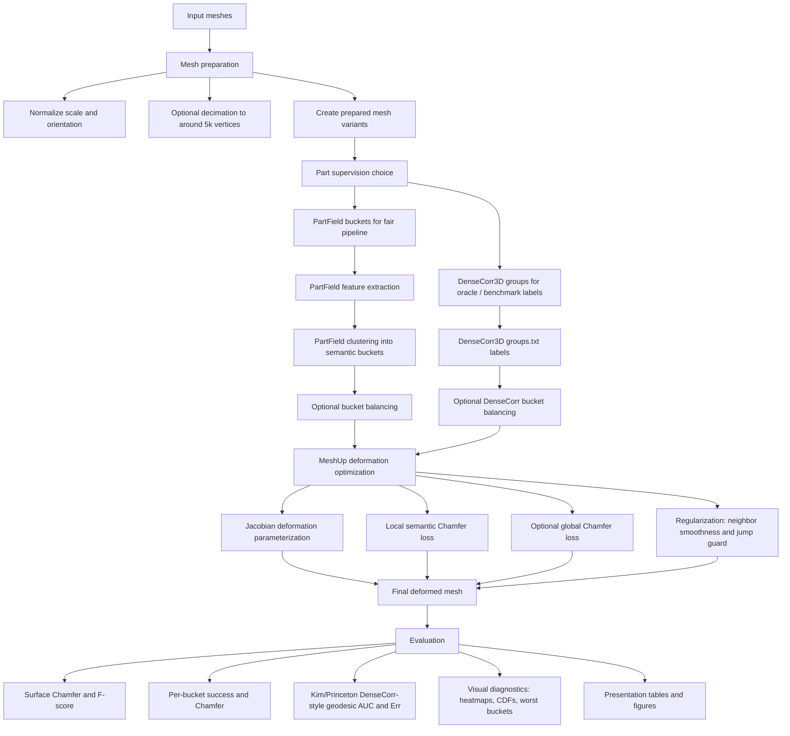

# MeshUp Cross-Animal Deformation: Detailed Project Presentation

## 1. Project Goal

The goal of this project is to deform a source animal mesh so that it becomes geometrically close to a target animal mesh while still preserving a coherent source topology.

In simple terms:

> Given a source mesh, such as a panther, elephant, horse, or panda, and a target mesh, such as a cheetah, giraffe, moose, or bear, optimize the source vertices so the final mesh occupies the target shape.

The scientific challenge is that cross-animal deformation is not just rigid alignment. The source and target can have very different proportions and part structure:

- elephant trunk versus giraffe neck
- short animal body versus long animal body
- thick legs versus thin legs
- different head/neck proportions
- missing or very small parts in one shape

The pipeline therefore needs both global shape matching and local part-aware matching.

## 2. High-Level Pipeline Graph

## 3. Pipeline From Start To Finish

### Step 1: Choose source and target meshes

There are two main mesh sources in the project:

1. SAM3D / custom animal meshes
   - These are good for qualitative demonstrations.
   - They do not come with official ground-truth correspondences.
   - Examples: `horse2_to_giraffe4`, `panda3_to_bear`, `fox_to_cat2`, `panda2_to_panda3`.

2. DenseCorr3D animal meshes
   - These are the most important for quantitative comparison.
   - Each folder contains `simple_mesh.obj`, `color_mesh.obj`, `groups.txt`, and `groups_visualization.obj`.
   - `groups.txt` gives supervised semantic region labels.
   - These labels are useful as held-out benchmark supervision.

Important DenseCorr3D animal folders:

| Animal / object | DenseCorr3D folder |
|---|---|
| panther | `external/DenseCorr3D/animals/071b8_toy_animals_017` |
| moose | `external/DenseCorr3D/animals/1d6d1_toy_animals_015` |
| elephant | `external/DenseCorr3D/animals/2d6b3_toy_animals_009` |
| giraffe | `external/DenseCorr3D/animals/34fb4_toy_animals_019` |
| bear | `external/DenseCorr3D/animals/96615_toy_animals_018` |
| cheetah | `external/DenseCorr3D/animals/bdfd0_toy_animals_016` |

The all-animal sweep also includes:

- `13cf7_toy_animals_055`
- `188f4_toy_animals_022`
- `4e94a_toy_animals_020`
- `d1889_dinosaur_002`

Prepared all-animal 5k/full variants:

`jobs_with_target_guidance/densematcher_runs/prepared/all_animals_20260803`

### Step 2: Prepare mesh variants

For DenseCorr3D, the pipeline prepares:

- full-resolution mesh variants
- 5k mesh variants
- pair-specific bucket-balanced variants

The 5k versions are important because:

- they run much faster;
- they make all pairs comparable in resolution;
- they make geodesic evaluation tractable;
- they reduce the chance that one mesh wins simply because it has denser sampling in a part.

Bucket balancing creates source and target variants where each semantic bucket has the same number of vertices. This matters because without balancing, a small target bucket, such as a thin neck or tail-like region, may have too few vertices to pull the source reliably.

### Step 3: Generate or load part labels

There are two different label sources, and the distinction is central to the fairness story.

#### PartField labels

PartField is used to generate part buckets from mesh geometry/features.

In the fair pipeline, PartField labels are used during deformation optimization.

Example existing PartField label locations:

`jobs_with_target_guidance/partfield_segments/densecorr3d_animals/densecorr3d_animals_20260706`

These include PF6, PF7, PF8, PF9, PF10 versions for several animal groups.

#### DenseCorr3D labels

DenseCorr3D `groups.txt` labels are supervised semantic labels from the benchmark.

Important distinction:

- DenseCorr labels are excellent for evaluation.
- DenseCorr labels should not be used to drive deformation if the goal is to fairly compare to DenseMatcher/DenseCorr numbers.

When DenseCorr labels drive deformation and also evaluate deformation, the result is an oracle-style upper bound.

### Step 4: Optimize deformation

The optimization deforms the source mesh into the target using the MeshUp deformation code.

The best current recipe uses:

| Component | Current setting / role |
|---|---|
| deformation parameterization | Jacobian deformation |
| semantic guidance | hard PartField/DenseCorr bucket Chamfer |
| source-to-target weight | `0.35` |
| target-to-source weight | `1.0` |
| partfield Chamfer weight | `8000.0` |
| global Chamfer weight | usually `0.0` in best part-only runs |
| Jacobian neighbor smoothness | `1000.0` |
| edge displacement jump guard | `500.0`, threshold around `1.2` |
| DINO/SDS image losses | disabled in the strongest current pipeline |
| output epochs | usually `4000`, one elephant->moose run used `20000` |

The final mesh is usually:

`<run_dir>/mesh_final/mesh.obj`

The colored output is often:

`<run_dir>/colored_meshes/mesh_final_position.ply`

## 4. Why Chamfer Loss Matters

### Global Chamfer

Global Chamfer compares the whole deformed source surface to the whole target surface.

For each point on the deformed source, it finds the nearest point on the target, and vice versa. The distances are averaged.

Global Chamfer is useful because it pulls the entire mesh into the target body envelope. It answers:

> Does the final shape occupy the same overall surface as the target?

But global Chamfer alone is dangerous for cross-animal deformation. It does not know that a leg should match a leg or a head should match a head. A source vertex on the body can match any nearby target point. This can produce:

- legs collapsing into body regions;
- neck regions matching torso regions;
- trunk or head regions getting pulled to the wrong nearby surface;
- good surface coverage but bad semantic alignment.

### Local / part-aware Chamfer

Local Chamfer computes Chamfer within corresponding buckets.

For bucket `k`:

- compare deformed source bucket `k` to target bucket `k`;
- do not allow source bucket `k` to match target bucket `j`.

This is the key part of the pipeline. It answers:

> Did each semantic region become the correct target semantic region?

Local Chamfer is why a panther head is pulled toward the target head, not just any nearby surface. It is also why legs stay leg-like more often than with global Chamfer alone.

The current loss is asymmetric:

- source-to-target weight `0.35`
- target-to-source weight `1.0`

This means target coverage is emphasized more strongly. The target-to-source direction prevents the final mesh from covering only easy parts and ignoring hard target regions.

## 5. Why PartField Matters

PartField gives the pipeline a way to divide arbitrary meshes into meaningful part buckets.

It matters because the mesh deformation problem is underconstrained without part information. Chamfer only tells us geometric closeness. PartField adds weak semantic structure.

PartField is especially useful because:

- it works on meshes outside DenseCorr3D;
- it can be used on SAM3D meshes and new custom objects;
- it avoids using benchmark labels during optimization;
- it gives a fair way to guide deformation and then test on DenseCorr labels afterward.

### Can DenseCorr / DenseMatcher replace PartField?

Short answer: not for the general pipeline.

DenseCorr3D labels are benchmark annotations. They are excellent for evaluating DenseCorr3D meshes, but they are not available for arbitrary new SAM3D meshes.

DenseMatcher is a correspondence method. It predicts dense semantic correspondences between known benchmark-like objects. It is not the same thing as a general-purpose segmentation module like PartField.

Use DenseCorr/DenseMatcher for:

- benchmark comparison;
- held-out evaluation labels;
- possible future correspondence priors if you can run the model and get predicted maps.

Use PartField for:

- driving deformation on arbitrary meshes;
- fair DenseCorr comparison;
- SAM3D/custom meshes;
- local part-aware Chamfer when DenseCorr labels are not available.

Best answer for the supervisor:

> DenseCorr3D is better as ground-truth evaluation supervision. PartField is better as our general deformation guidance because it can be applied to new meshes. If we use DenseCorr groups to both guide and evaluate, the numbers become an oracle ablation, not a fair headline result.

## 6. Computational Cost

The standard deformation jobs are Slurm H100 dev jobs:

| Resource | Typical setting |
|---|---|
| GPU | 1 H100 |
| CPUs | 8 |
| memory allocation | 50 GB |
| time limit | 30 minutes |
| actual CPU max RSS | roughly 1.4 to 1.8 GB in measured runs |

Observed runtimes:

| Run type | Example job | Runtime |
|---|---|---:|
| DenseCorr 5k, 4000 epochs | bear->panther, cheetah->panther, elephant->giraffe | about 3:49 to 4:47 |
| DenseCorr 5k, 20000 epochs | elephant->moose | 18:19 |
| PartField-guided selected dense/simple meshes, 4000 epochs | selected PF runs | about 13:37 to 15:21 |
| SAM3D selected 4000 epochs | selected PartField/SAM3D runs | often around 13 to 15 minutes |

The 5k DenseCorr runs are very fast because the mesh resolution is controlled and the deformation is optimized directly on geometry. The SAM3D/custom mesh runs are slower because mesh resolution, preprocessing, and geometry complexity vary.

The all-animal DenseCorr sweep is currently submitted as a self-chaining job rather than one huge array because the cluster rejected a 90-task array due to QOS submit limits.

Current chain job:

`6130218`

Output root:

`jobs_with_target_guidance/cross_animal_spike_runs/outputs/densecorr3d_all_animals_bucketbalanced_5k_best_asym035`

## 7. Best Mesh Outputs

### New challenging DenseCorr outputs

| Pair | Output directory | Notes |
|---|---|---|
| elephant->moose, 20k epochs | `jobs_with_target_guidance/cross_animal_spike_runs/outputs/densecorr3d_bucketbalanced_requested_5k_20k_30min/elephant_to_moose_elephant_moose_bucketavg5001_densecorr3d_bucketbalanced_requested_5k_20k_30min_hard_partfield_chamfer_only_densecorr3d_groups_pfonly_best_asym035_jneighbor1000_jump500_20000ep_6123510` | completed |
| elephant->panther | `jobs_with_target_guidance/cross_animal_spike_runs/outputs/densecorr3d_bucketbalanced_extra_5k_best_asym035/elephant_to_panther_elephant_panther_bucketavg_densecorr3d_bucketbalanced_extra_5k_hard_partfield_chamfer_only_densecorr3d_groups_pfonly_best_asym035_jneighbor1000_jump500_4000ep_6123511` | completed |
| panther->giraffe | `jobs_with_target_guidance/cross_animal_spike_runs/outputs/densecorr3d_bucketbalanced_extra_5k_best_asym035/panther_to_giraffe_panther_giraffe_bucketavg_densecorr3d_bucketbalanced_extra_5k_hard_partfield_chamfer_only_densecorr3d_groups_pfonly_best_asym035_jneighbor1000_jump500_4000ep_6123512` | completed |

### Strong older DenseCorr bucket-balanced outputs

| Pair | Output directory |
|---|---|
| panther->cheetah | `jobs_with_target_guidance/cross_animal_spike_runs/outputs/densecorr3d_bucketbalanced_requested_5k_best_asym035/panther_to_cheetah_panther_cheetah_bucketavg4999_densecorr3d_bucketbalanced_requested_5k_hard_partfield_chamfer_only_densecorr3d_groups_pfonly_best_asym035_jneighbor1000_jump500_4000ep_5698613` |
| bear->panther | `jobs_with_target_guidance/cross_animal_spike_runs/outputs/densecorr3d_bucketbalanced_requested_5k_best_asym035/bear_to_panther_bear_panther_bucketavg5002_densecorr3d_bucketbalanced_requested_5k_hard_partfield_chamfer_only_densecorr3d_groups_pfonly_best_asym035_jneighbor1000_jump500_4000ep_5708092` |
| cheetah->panther | `jobs_with_target_guidance/cross_animal_spike_runs/outputs/densecorr3d_bucketbalanced_requested_5k_best_asym035/cheetah_to_panther_panther_cheetah_bucketavg4999_densecorr3d_bucketbalanced_requested_5k_hard_partfield_chamfer_only_densecorr3d_groups_pfonly_best_asym035_jneighbor1000_jump500_4000ep_5708134` |
| elephant->giraffe | `jobs_with_target_guidance/cross_animal_spike_runs/outputs/densecorr3d_bucketbalanced_requested_5k_best_asym035/elephant_to_giraffe_elephant_giraffe_bucketavg4998_densecorr3d_bucketbalanced_requested_5k_hard_partfield_chamfer_only_densecorr3d_groups_pfonly_best_asym035_jneighbor1000_jump500_4000ep_5708825` |
| giraffe->elephant | `jobs_with_target_guidance/cross_animal_spike_runs/outputs/densecorr3d_bucketbalanced_requested_5k_best_asym035/giraffe_to_elephant_elephant_giraffe_bucketavg4998_densecorr3d_bucketbalanced_requested_5k_hard_partfield_chamfer_only_densecorr3d_groups_pfonly_best_asym035_jneighbor1000_jump500_4000ep_5709026` |

### Strong SAM3D/custom examples

| Pair | Output directory |
|---|---|
| horse2->giraffe4 | `jobs_with_target_guidance/cross_animal_spike_runs/outputs/sam3d_selected_best_asym035_jump500_4000/horse2_to_giraffe4_sam3d_selected_pf08_4000_hard_partfield_chamfer_only_horse2_to_giraffe4_pf08_pfonly_best_asym035_jneighbor1000_jump500_4000ep_4000ep_5816558` |
| panda3->bear | `jobs_with_target_guidance/cross_animal_spike_runs/outputs/sam3d_selected_best_asym035_jump500_4000/panda3_to_bear_sam3d_selected_pf07_4000_hard_partfield_chamfer_only_panda3_to_bear_pf07_pfonly_best_asym035_jneighbor1000_jump500_4000ep_4000ep_5817242` |
| fox->cat2 | `jobs_with_target_guidance/cross_animal_spike_runs/outputs/sam3d_selected_best_asym035_jump500_4000/fox_to_cat2_sam3d_selected_pf07_4000_hard_partfield_chamfer_only_fox_to_cat2_pf07_pfonly_best_asym035_jneighbor1000_jump500_4000ep_4000ep_5818235` |
| panda2->panda3 | `jobs_with_target_guidance/cross_animal_spike_runs/outputs/sam3d_selected_best_asym035_jump500_4000/panda2_to_panda3_sam3d_selected_pf09_4000_hard_partfield_chamfer_only_panda2_to_panda3_pf09_pfonly_best_asym035_jneighbor1000_jump500_4000ep_4000ep_5818235` |

## 8. Best Images And Videos To Show

### Showreels

| Asset | Path |
|---|---|
| start/final showreel | `jobs_with_target_guidance/cross_animal_spike_runs/reports/showoff_start_final_partfield_showreel.mp4` |
| slow deformation showreel | `jobs_with_target_guidance/cross_animal_spike_runs/reports/showoff_deformation_slow_partfield_showreel.mp4` |

### Per-run videos

Good examples:

- `jobs_with_target_guidance/cross_animal_spike_runs/reports/showoff_per_run_front_scaled/start_final/01_horse2_giraffe4_start_final_partfield.mp4`
- `jobs_with_target_guidance/cross_animal_spike_runs/reports/showoff_per_run_front_scaled/start_final/02_panda3_bear_start_final_partfield.mp4`
- `jobs_with_target_guidance/cross_animal_spike_runs/reports/showoff_per_run_front_scaled/start_final/04_elephant_moose_start_final_partfield.mp4`
- `jobs_with_target_guidance/cross_animal_spike_runs/reports/showoff_per_run_front_scaled/start_final/10_elephant_giraffe_start_final_partfield.mp4`

### Diagnostic images

Use these to explain success and failure:

| Topic | Image |
|---|---|
| PartField/DenseCorr bucket balancing preview | `jobs_with_target_guidance/cross_animal_spike_runs/reports/partfield_segmentation_previews/pf8pos025bucketavg_balanced_used.png` |
| elephant->giraffe worst bucket image | `jobs_with_target_guidance/cross_animal_spike_runs/evaluation/bucket_discrepancy/plots/elephant_to_giraffe/elephant_to_giraffe_5k_densecorr3d_requested_animals_hard_partfield_chamfer_only_densecorr3d_groups_pfonly_best_asym035_worst_chamfer_buckets.png` |
| elephant->giraffe semantic heatmap | `jobs_with_target_guidance/cross_animal_spike_runs/evaluation/bucket_discrepancy/plots/elephant_to_giraffe/elephant_to_giraffe_5k_densecorr3d_requested_animals_hard_partfield_chamfer_only_densecorr3d_groups_pfonly_best_asym035_semantic_vertex_chamfer_heatmap.png` |
| elephant->giraffe CDF | `jobs_with_target_guidance/cross_animal_spike_runs/evaluation/bucket_discrepancy/plots/elephant_to_giraffe/elephant_to_giraffe_5k_densecorr3d_requested_animals_hard_partfield_chamfer_only_densecorr3d_groups_pfonly_best_asym035_vertex_chamfer_cdf.png` |
| panther->cheetah good case heatmap | `jobs_with_target_guidance/cross_animal_spike_runs/evaluation/bucket_discrepancy/plots/panther_to_cheetah/panther_to_cheetah_panther_cheetah_bucketavg4999_densecorr3d_bucketbalanced_requested_5k_hard_partfield_chamfer_only_den_semantic_vertex_chamfer_heatmap.png` |
| panther->cheetah good case CDF | `jobs_with_target_guidance/cross_animal_spike_runs/evaluation/bucket_discrepancy/plots/panther_to_cheetah/panther_to_cheetah_panther_cheetah_bucketavg4999_densecorr3d_bucketbalanced_requested_5k_hard_partfield_chamfer_only_den_vertex_chamfer_cdf.png` |

## 9. Numbers To Present

### A. Fair comparison to DenseMatcher

This is the most important table because it avoids cheating.

In this table:

- deformation guidance uses PartField;
- DenseCorr labels are not used in the loss;
- DenseCorr `groups.txt` is loaded only afterward for evaluation.

Report:

`jobs_with_target_guidance/cross_animal_spike_runs/evaluation/bucket_discrepancy/densecorr_partfield_guided_fair_existing_kim_geodesic_auc.md`

| Setting | n | mean AUC | mean Err | same-bucket rate |
|---|---:|---:|---:|---:|
| PartField-guided, all PF6/PF7/PF8 | 12 | 0.9550 | 1.1721 | 0.8309 |
| PartField-guided, PF8 only | 4 | 0.9648 | 0.8833 | 0.8515 |
| PartField-guided, PF7 only | 4 | 0.9607 | 0.9839 | 0.8383 |
| PartField-guided, PF6 only | 4 | 0.9397 | 1.6491 | 0.8028 |
| DenseMatcher reported | paper | 0.845 | 1.74 | not reported in our table |

Best fair individual run:

| Pair | Guidance | Evaluation | AUC | Err | same-bucket |
|---|---|---|---:|---:|---:|
| panther->cheetah PF8 | PartField | DenseCorr `groups.txt` | 0.9790 | 0.5237 | 0.8545 |

How to say it:

> In the fair setting, MeshUp is driven by PartField but evaluated on held-out DenseCorr semantic groups. Under this setup we get mean AUC 0.955 and Err 1.17, compared with DenseMatcher's reported AUC 0.845 and Err 1.74.

Important caveat:

> These numbers are the closest fair comparison currently available, but they are still not the full official DenseMatcher benchmark. They use the available local DenseCorr animal meshes and a deformation-induced nearest-target correspondence.

### B. Oracle / upper-bound DenseCorr-guided comparison

This table is useful, but it should not be the headline comparison because DenseCorr labels are used both in optimization and evaluation.

Report:

`jobs_with_target_guidance/cross_animal_spike_runs/evaluation/bucket_discrepancy/densecorr_kim_princeton_geodesic_auc.md`

| Method | n | mean AUC | mean Err | same-bucket rate |
|---|---:|---:|---:|---:|
| DenseCorr bucket-balanced 5k | 7 | 0.9934 | 0.1724 | 0.9468 |
| DenseCorr source-stable 5k | 7 | 0.9939 | 0.1603 | 0.9473 |
| DenseCorr requested animals | 2 | 0.9879 | 0.3216 | 0.9139 |

Recent new oracle runs:

Report:

`jobs_with_target_guidance/cross_animal_spike_runs/evaluation/bucket_discrepancy/densecorr_recent_new_runs_kim_geodesic_auc.md`

| Pair | AUC | Err | same-bucket rate |
|---|---:|---:|---:|
| panther->giraffe | 0.9961 | 0.0970 | 0.9544 |
| elephant->moose 20k | 0.9946 | 0.1362 | 0.9476 |
| elephant->panther | 0.9926 | 0.1845 | 0.9314 |

Use this as:

> DenseCorr-guided runs show the upper bound of the deformation machinery when high-quality semantic buckets are available.

### C. Chamfer / F-score / bucket discrepancy table

Report:

`jobs_with_target_guidance/cross_animal_spike_runs/evaluation/bucket_discrepancy/presentation_tables.md`

Method-level summary:

| Method | n | mean F@0.02 | mean min-bucket F | mean bucket Chamfer | mean AUC | pattern |
|---|---:|---:|---:|---:|---:|---|
| SAM3D selected | 4 | 0.964 | 0.914 | 0.0165 | 0.724 | uniformly good |
| Chain | 2 | 0.927 | 0.806 | 0.0185 | 0.681 | mixed/good |
| DenseCorr bucket-balanced 5k | 7 | 0.878 | 0.749 | 0.0262 | 0.680 | mixed |
| DenseCorr source-stable 5k | 7 | 0.879 | 0.718 | 0.0256 | 0.684 | mixed |
| DenseCorr requested animals | 4 | 0.767 | 0.465 | 0.0426 | 0.656 | localized bad buckets |

Best SAM3D-style examples:

| Pair | mean F@0.02 | mean bucket CD | AUC | p95 err |
|---|---:|---:|---:|---:|
| panda3->bear | 0.986 | 0.0145 | 0.721 | 0.014 |
| horse2->giraffe4 | 0.985 | 0.0108 | 0.816 | 0.012 |
| fox->cat2 | 0.955 | 0.0191 | 0.721 | 0.020 |

## 10. What Each Main Metric Means

### F@0.02

F-score at threshold 0.02.

Interpretation:

> What fraction of deformed points are close enough to the target, and what fraction of target points are covered by the deformation?

Higher is better. A value near 1.0 means most of the surface is within the threshold.

### Chamfer Distance / CD

Chamfer Distance is the average nearest-neighbor surface distance in both directions.

In the bucket table, bucket CD is computed inside semantic buckets:

- deformed source bucket -> target bucket;
- target bucket -> deformed source bucket;
- summed into bidirectional Chamfer.

Lower is better.

### Max bucket CD

This is the worst bucket Chamfer for a run.

Interpretation:

> Is one local region failing badly even if the whole mesh looks decent?

This is important because elephant/giraffe failures are often localized around neck/trunk/head-like regions.

### Kim/Princeton geodesic AUC

For every deformed source vertex:

1. find its nearest target vertex;
2. look up the source vertex's semantic group;
3. measure geodesic distance on the target mesh from the predicted target vertex to the nearest target vertex in the correct semantic group;
4. normalize by `sqrt(target surface area)`;
5. plot threshold versus percentage correct;
6. integrate the curve from 0 to 0.25.

Higher AUC is better.

### Err

Err is mean normalized geodesic error times 100.

Lower Err is better.

DenseMatcher reports AUC and Err, which is why this metric is the closest comparison to the paper.

## 11. Failure Cases

### Main failure: elephant <-> giraffe neck/trunk/head regions

The most difficult pair is elephant->giraffe and the reverse.

Observed numbers:

| Pair | Method | mean F@0.02 | min F | max bucket CD | bad buckets | pattern |
|---|---|---:|---:|---:|---:|---|
| elephant->giraffe | DenseCorr bucket-balanced 5k | 0.802 | 0.605 | 0.1050 | 3 | localized bad buckets |
| elephant->giraffe | DenseCorr source-stable 5k | 0.668 | 0.325 | 0.1143 | 4 | localized bad buckets |
| giraffe->elephant | DenseCorr bucket-balanced 5k | 0.837 | 0.645 | 0.0438 | 1 | localized bad buckets |

Worst buckets for elephant->giraffe include buckets `7`, `1`, and `3` depending on variant.

Why it happens:

1. Extreme proportion mismatch.
   - Giraffe has a long neck.
   - Elephant has trunk/head geometry instead.
   - A single semantic bucket may contain a long thin target part that the source cannot easily cover without stretching.

2. Chamfer is set-based, not point-to-point.
   - Any vertex in a bucket can match any nearby vertex in the same bucket.
   - This is good for flexibility, but bad for exact correspondence.
   - It can allow sliding along long thin parts.

3. Topology is fixed.
   - The source mesh topology cannot create a new long neck or split/merge parts freely.
   - It can only stretch, bend, and redistribute existing vertices.

4. Thin structures are unstable.
   - A long neck or trunk has high aspect ratio.
   - Nearest-neighbor losses can pull opposite sides together.
   - This can create folds or local self-overlap.

5. Bucket labels may be too coarse.
   - If head, neck, trunk, or upper torso share a bucket or boundary, the optimizer can satisfy the bucket loss while still placing local subparts incorrectly.

### Folding failure

Folding happens when the deformation is pulled hard by the target Chamfer but regularization is not strong enough to preserve local orientation.

Contributors:

- local Chamfer pulls vertices toward target regions without exact correspondence;
- long-range deformation can move neighboring source vertices in different directions;
- thin parts can collapse because both sides match nearby target points;
- Jacobian smoothness helps, but does not fully prevent self-intersection.

## 12. How To Fix The Main Failure Modes

Best next fixes:

1. Finer buckets around head/neck/trunk.
   - Split problematic DenseCorr/PartField buckets into subparts.
   - Use 12 to 32 buckets for hard cases.

2. Add semantic vertex anchors.
   - Use high-confidence PartField/DenseMatcher correspondences as sparse anchors.
   - Do not use DenseCorr ground truth anchors in the fair benchmark.

3. Add stronger anti-folding regularization.
   - edge stretch penalty;
   - normal flip penalty;
   - local ARAP-style preservation;
   - self-intersection or repulsion penalty for thin parts.

4. Use staged optimization.
   - Stage 1: global body alignment.
   - Stage 2: local bucket Chamfer.
   - Stage 3: hard regions with stronger regularization.

5. Use intermediate chain deformation.
   - Example: panther -> horse -> giraffe.
   - This helps when source and target are too far apart anatomically.

6. Balance buckets before optimization.
   - The bucket-balanced 5k runs improved stability compared with unbalanced requested animals.

## 13. Recommended Presentation Structure

### Slide 1: Goal

"We deform a source animal mesh into a target animal mesh while preserving coherent topology and matching semantic parts."

### Slide 2: Why this is hard

Show elephant/giraffe and explain:

- no exact point-to-point labels for arbitrary meshes;
- very different proportions;
- thin parts fold;
- global nearest-neighbor matching is ambiguous.

### Slide 3: Pipeline graph

Use the Mermaid graph from this document.

### Slide 4: Mesh sources

Explain:

- SAM3D/custom meshes for qualitative demonstrations;
- DenseCorr3D meshes for supervised quantitative benchmark comparison.

### Slide 5: PartField guidance

Explain PartField:

- gives buckets on arbitrary meshes;
- enables local Chamfer;
- is fair because it does not use DenseCorr labels during optimization.

### Slide 6: Loss function

Show:

- local bucket Chamfer;
- optional global Chamfer;
- Jacobian smoothness;
- jump guard.

### Slide 7: Best qualitative results

Show:

- horse2->giraffe4 video;
- panda3->bear video;
- panther->cheetah heatmap;
- panther->giraffe recent mesh.

### Slide 8: Fair DenseMatcher comparison

Use the fair table:

| Method | AUC | Err |
|---|---:|---:|
| DenseMatcher | 0.845 | 1.74 |
| Ours, PartField-guided all rows | 0.955 | 1.17 |
| Ours, PartField-guided PF8 | 0.965 | 0.883 |

### Slide 9: Oracle upper bound

Use DenseCorr-guided numbers only as upper bound:

| Method | AUC | Err |
|---|---:|---:|
| DenseCorr-guided bucket-balanced 5k | 0.993 | 0.172 |

Say:

> This is not our fair headline, but it shows the deformation engine can exploit high-quality semantic supervision when available.

### Slide 10: Failure cases

Show elephant->giraffe worst bucket image and heatmap.

Explain:

- long neck/trunk mismatch;
- bucket ambiguity;
- topology fixed;
- thin structures fold.

### Slide 11: Next improvements

List:

- finer buckets;
- anti-folding penalties;
- sparse correspondence anchors;
- staged optimization;
- intermediate chain deformation.

## 14. Final Thesis Statement

The core contribution is a part-aware mesh deformation pipeline that uses local semantic Chamfer loss to deform source meshes into target animal shapes. PartField provides general semantic buckets for arbitrary meshes, while DenseCorr3D provides a supervised benchmark for fair evaluation. In the fair setting, where PartField drives deformation and DenseCorr labels are used only for evaluation, the pipeline reaches stronger AUC/Err than DenseMatcher's reported animal-style correspondence metric on the tested DenseCorr animal pairs. The main remaining weakness is localized deformation of extreme thin structures such as giraffe necks and elephant trunk/head regions, where fixed topology and set-based Chamfer can produce stretching or folding.

